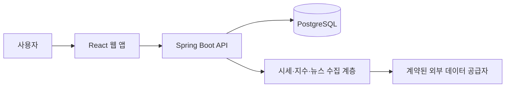

# 주식 관리 서비스 개발 계획

최종 갱신: 2026-10-14  
상태: 초기 기획

## 1. 제품 목표

사용자별로 국내·미국 관심 종목을 관리하고, 무료 이용이 허용된 범위에서 가격·등락률·관련 뉴스와 주요 시장 지수를 확인하는 웹 서비스. 첫 출시는 국내와 미국 주식을 지원하고, 이후 해외 시장을 점진적으로 확대한다.

### 확정된 요구사항

- 국내 주식과 해외 주식을 모두 지원한다.
- 첫 출시의 해외 시장은 미국 주식으로 한정하고, 이후 다른 국가로 확대한다.
- 사용자별 관심 종목과 데이터 접근을 분리한다. 무료 공급자가 다중 사용자 표시를 허용하지 않으면 실제 공급자 데이터는 로컬·개발 환경에서만 사용한다.
- 첫 출시는 관심 종목 관리에 집중하고, 보유 수량·평균 매입가·평가손익은 후속 단계로 옮긴다.
- 시세 화면은 1분마다 자동 갱신한다.
- 1~2분 지연은 목표 조건으로 기록하되, 무료 공급자가 보장하지 못하면 공급자가 제공하는 갱신 주기 내 반영으로 완화한다. 실제 공급자 지연 시간은 화면에 표시한다.
- 시간과 표시 기준은 `Asia/Seoul`을 사용한다. 미국 거래소 시간은 서머타임을 포함해 한국시간으로 변환하고 원본 시간도 보존한다.
- 공급자 장애 시 마지막 정상 가격을 유지하고 `업데이트 중` 상태를 표시한다.
- 백엔드는 **Spring Boot**, 프론트엔드는 **React**로 개발한다.
- 기획과 변경 사항은 이 Markdown 파일에 계속 기록한다.

### 첫 출시 이후

- 보유 수량·평균 매입가 입력과 평가손익은 후속 단계에서 설계한다. (확정)
- 증권사 계좌 연동과 매매 주문은 별도 후속 과제로 검토한다. (제안)

후속 기능의 우선순위와 상세 범위는 별도로 결정한다.

## 2. 첫 출시 범위(MVP)

| 영역 | 기능 | 완료 기준 |
| --- | --- | --- |
| 계정 | 이메일 회원가입, 로그인, 로그아웃, 계정 삭제 | 소셜 로그인 없이 이메일 계정만 사용하며 사용자별 데이터 접근이 분리된다. |
| 종목 | 국내·미국 종목 검색, 관심 종목 등록·삭제 | 동일한 종목명을 구분할 수 있도록 시장과 종목 코드를 함께 표시한다. |
| 시세 | 가격, 등락액·등락률, 기준 시각, 통화, 1분마다 자동 갱신 | 화면 갱신 시각, 공급자 원본 시각, 지연 상태를 구분해 표시한다. |
| 지수 | KOSPI, KOSDAQ, 미국 주요 지수 | 지수별 기준 시각과 제공 출처를 표시한다. |
| 뉴스 | 관심 종목 관련 기사 제목, 출처, 발행 시각, 원문 링크 | 각 결과에서 원문으로 이동할 수 있다. |
| 대시보드 | 관심 종목, 지수, 뉴스를 한눈에 조회 | 로그인 후 핵심 정보를 한 화면에서 확인할 수 있다. |

첫 출시 이후 후보: 보유 수량·평균 매입가·평가손익, 증권사 계좌 연동, 거래 내역 기반 손익, 가격 알림, 뉴스 요약, ETF 및 미국 외 시장 확대.

초기 운영 원칙: 유료 API와 유료 데이터 라이선스를 사용하지 않는다. 오픈소스 구성을 우선하고 개인 서버 또는 로컬 실행을 지원한다. 무료 이용 조건을 충족하지 않는 상업 운영과 다중 사용자 데이터 재배포는 MVP에서 제외한다. 초기 사용자 수가 늘어나기 전까지 별도 대규모 인프라를 전제로 하지 않는다.

## 3. 기술 구성

| 계층 | 선택 | 역할 |
| --- | --- | --- |
| 프론트엔드 | React + TypeScript, Vite 제안 | Figma 설계를 기반으로 대시보드, 종목 검색, 관심 종목 화면 구현 |
| 백엔드 | Spring Boot + Java, REST API | 인증, 사용자 데이터 관리, 시세·뉴스 조회 API |
| 데이터베이스 | PostgreSQL 제안 | 사용자, 종목, 관심 종목, 데이터 갱신 기록 |
| 데이터 수집 | Spring Boot 스케줄 작업 또는 별도 워커 | 공급자 API 호출, 정규화, 중복 제거 및 갱신 |
| 배포 | 개인 서버 또는 로컬 실행 우선, Docker Compose 제안 | 무료 조건 내 환경 설정, 비밀키 관리, 장애 추적 |

### 주요 데이터 모델 초안

- `users`: 계정과 인증 정보
- `securities`: 시장, 종목 코드, 종목명, 거래 통화
- `watchlist_items`: 사용자별 관심 종목
- `quotes`: 종목별 가격, 통화, 거래일, 원본 기준 시각, 공급자
- `indices`: 지수 식별자, 값, 표시 기준 시각(Asia/Seoul), 원본 기준 시각, 공급자
- `news_items`: 기사 제목, 출처, 발행 시각, 원문 발행 시각, 원문 URL, 연결 종목
- `data_provider_status`: 공급자, 마지막 성공 시각, 마지막 실패 시각, 상태, 오류 메시지

후속 단계 모델: `holdings`(사용자별 보유 수량·평균 매입가). 평가손익을 추가할 때 환율과 기준 시각도 설계한다.

같은 티커가 시장마다 존재할 수 있으므로 종목은 **시장 + 종목 코드**로 식별한다. 모든 시간은 저장 시 UTC 또는 원본 시간대 정보를 보존하고, 표시 시 `Asia/Seoul`로 변환한다. 미국 거래소 시간은 거래소 시간대와 서머타임 규칙을 사용해 변환한다. 시세는 사용자별로 공급자 API를 호출하지 않고, 서버가 필요한 종목의 가격을 모아 갱신한 뒤 여러 사용자에게 같은 결과를 제공한다. 프론트엔드는 60초마다 백엔드 데이터를 다시 조회한다. 공급자 장애가 발생하면 마지막 정상 가격을 유지하고 `업데이트 중` 상태를 표시한다.

## 4. 데이터 공급 계획 및 선행 확인

데이터 공급자는 구현 전에 **무료 이용 조건**, 다중 사용자 웹사이트 표시 권한, 갱신 주기, 호출 한도, 저장 기간, 지수 사용 권한을 확인한 뒤 확정한다. 유료 요금제나 유료 라이선스가 필요한 후보는 MVP 운영 공급자에서 제외한다.

| 데이터 | 조사할 공급 경로 | 확인할 사항 |
| --- | --- | --- |
| 국내 시세·지수 | 무료 이용이 허용된 KRX OPEN API 등 | 무료 호출 한도, 제공 주기, 표시·재배포 조건 |
| 미국 시세·지수 | Alpha Vantage, Finnhub의 무료 범위 등 | 무료 호출 한도, 무료 지연 시세 범위, 표시·재배포 조건 |
| 국내 뉴스 | NAVER Search API / NAVER API HUB의 무료 범위 | 무료 호출 한도, 원문 링크·출처 표시, 캐시·다중 사용자 조건 |
| 해외 뉴스 | Alpha Vantage News & Sentiment 등 무료 범위 | 무료 호출 한도, 기사 메타데이터 저장·표시·재배포 조건 |
| 환율(후속) | Frankfurter | 일별 갱신, 무료 상업 이용 조건, 오픈소스 self-hosting 가능 여부 |

KRX OPEN API 목록에는 국내 주식과 KOSPI·KOSDAQ 지수의 일별 정보가 있다. 이 API를 사용해 화면을 1분마다 갱신하더라도 원본 시세가 1분마다 새로 생성되는 것은 아니다. 실시간 상품은 별도로 안내된다. 미국 데이터의 개인용 요금제가 다중 사용자 서비스에 적합하다고 가정하지 않는다. 네이버 검색 API는 결과 표시와 저장에 조건이 있으며, 신규 신청은 NAVER API HUB에서 이뤄진다. 아래 후보의 무료 조건은 개발·검증 기준이며, 공개 운영 전에는 최신 약관과 공급자 승인 여부를 다시 확인한다.

### 무료·오픈소스 후보 조사

| 후보 | 무료 범위·호출 한도 | 서비스 이용 판단 |
| --- | --- | --- |
| KRX OPEN API | 국내 주식·KOSPI·KOSDAQ 등 일별 정보. 인증키 신청과 API 활용 신청이 필요하며 호출 횟수는 서비스별로 별도 지정될 수 있다. | 비상업적·비제3자 제공 조건이 있으므로 공개 다중 사용자 데이터 기능에는 사용하지 않는다. 로컬·개발용 일별 데이터 후보이며 1분 원본 갱신은 제공하지 않는다. |
| KIS Developers | 국내·해외 주식 REST 시세와 실시간 WebSocket API를 제공한다. 공통 무료 호출 한도는 문서에서 확인하지 못했다. | 무료 이용과 제휴 조건이 명확히 확인되기 전까지 MVP 공급자로 확정하지 않는다. 무료 조건을 충족하지 않는 다중 사용자 표시·상업 기능은 제외한다. |
| Alpha Vantage | 일반 무료 키는 대부분 데이터셋에 대해 하루 25회. 검증된 오픈소스·교육 프로젝트는 무제한 API 요청을 안내한다. 미국 실시간·15분 지연 시세는 무료가 아니라 프리미엄 범위다. | 오픈소스·로컬 개발 후보. 무료 키의 호출 한도와 이용 조건 내에서만 사용하고, 무료 범위를 넘는 운영·다중 사용자 표시 기능은 MVP에서 제외한다. |
| Finnhub | Basic·Standard는 공식 요금제에 분당 150·300회로 표시되며 라이선스가 `Personal Use`다. | 개인·로컬 테스트 후보. 상업·재배포 권한이 필요한 다중 사용자 기능은 유료 계약 없이 MVP에서 제외한다. |
| NAVER Search API | 뉴스 검색 포함 하루 25,000회. 검색 결과 출처와 원문 링크를 표시해야 하며 결과 데이터 저장·제3자 제공·수익화에 조건이 있다. | 무료 조건 내 로컬·개발 후보. 다중 사용자 표시·상업 이용 조건을 충족하지 못하면 공개 뉴스 기능은 MVP에서 제외한다. |
| Frankfurter | API 키 없이 일별 환율을 제공한다. 공개 API는 남용 방지 rate limit이 있지만 일·월 quota는 없으며 MIT 오픈소스와 self-hosting이 가능하다. | 후속 평가손익용 무료 환율 후보. 실시간 환율로 사용하지 않으며 공개 API 또는 self-hosting 범위에서 사용한다. |

현재 결론: MVP에서는 유료 API와 유료 데이터 라이선스를 사용하지 않는다. 무료 공급자의 이용 조건이 다중 사용자 표시나 상업 이용을 허용하지 않으면 해당 공급자 데이터는 로컬·개발 환경에서만 사용하고, 공개 다중 사용자 데이터 기능은 MVP에서 제외한다. 화면은 1분마다 polling하지만 원본 데이터는 무료 공급자가 제공하는 주기에 따라 갱신한다.

- [KRX OPEN API 서비스 목록](https://openapi.krx.co.kr/contents/OPP/INFO/service/OPPINFO004.cmd)
- [KRX OPEN API 이용약관](https://openapi.krx.co.kr/contents/OPP/INFO/OPPINFO002.jsp)
- [KRX 데이터 분배상품](https://openapi.krx.co.kr/contents/OPP/DATA/OPPDATA002.jsp)
- [KIS Developers API 안내](https://apiportal.koreainvestment.com/apiservice)
- [KIS 제휴사 API 안내](https://apiportal.koreainvestment.com/provider-doc1)
- [Alpha Vantage 무료 API 한도](https://www.alphavantage.co/support/api-key/)
- [Alpha Vantage 이용약관](https://www.alphavantage.co/terms_of_service/)
- [Finnhub API 요금·라이선스](https://api.finnhub.io/pricing-forex-api)
- [NAVER 검색 API 이용약관](https://developers.naver.com/products/terms/)
- [NAVER API HUB 이관 안내](https://developers.naver.com/notice/article/32530)
- [NAVER Search API 호출 한도](https://developers.naver.com/products/intro/plan/plan.md)
- [Alpha Vantage 뉴스 API 문서](https://www.alphavantage.co/documentation/)
- [Frankfurter API](https://frankfurter.dev/)
- [Frankfurter 라이선스·데이터 조건](https://frankfurter.dev/license/)

## 5. 구현 순서

| 단계 | 작업 | 산출물 |
| --- | --- | --- |
| 0. 화면 설계 | Figma로 로그인, 종목 검색, 관심 종목, 대시보드, 데이터 상태 표시 화면 설계 | 승인 가능한 화면 흐름과 컴포넌트 규칙 |
| 1. 기본 구조 | React·Spring Boot 프로젝트, PostgreSQL, Docker Compose, 이메일 인증, DB 마이그레이션 | 로컬에서 실행되는 기본 앱 |
| 2. 백엔드 API | 종목 검색, 관심 종목 CRUD, 시세·지수·뉴스 조회, 공급자 상태 API | API 명세와 Spring Boot 구현 |
| 3. 데이터 연동 | 무료 후보 연결, 시세·지수·뉴스 정규화, 공급자 제공 주기에 맞춘 수집 작업, 시간대 변환 | 출처·원본 시각·갱신 상태가 있는 API |
| 4. 프론트엔드 | Figma 기반 React 화면 구현, 1분 polling, 마지막 가격·업데이트 중 표시 | MVP 화면 |
| 5. 검증·시험 운영 | 권한 분리, 시간대·서머타임, 무료 공급자 제공 주기, 공급자 장애·호출 한도·이용 조건 확인 | 개인 서버·로컬 시험 버전 |

후속 단계: 보유 수량·평균 매입가 입력, 평가손익 및 환율 계산을 설계·구현한다.

### MVP 검증 기준

- 로컬·개발 환경에서 두 사용자 계정의 관심 종목이 서로 노출되지 않는다.
- 국내·미국 종목을 각각 검색하고 등록할 수 있다.
- 시세 화면은 60초마다 자동 갱신하고, 공급자 데이터의 원본 시각과 화면 갱신 시각을 별도로 보여준다.
- 무료 공급자의 제공 주기 안에 데이터가 갱신되면 정상으로 표시하고, 제공 주기를 초과하거나 수집 실패하면 마지막 가격과 `업데이트 중` 상태를 표시한다.
- 미국 거래소의 장 시간과 서머타임을 한국시간으로 정확히 표시하고 원본 시간도 확인할 수 있다.
- 가격·지수·뉴스에 출처와 기준 시각을 확인할 수 있다.
- 데이터가 늦거나 공급자가 실패해도 이전 데이터의 기준 시각을 보여주고 오류를 숨기지 않는다.

## 6. 미결정 사항

1. 무료 공급자별 제공 주기와 무료 이용 범위를 최종 확인
2. 무료 공급자가 다중 사용자 표시를 허용하는지 확인하고, 허용하지 않으면 해당 기능을 MVP에서 제외
3. 초기 사용자를 1인 또는 소수 사용자로 제한할 기간
4. 무료 조건만으로 공개 운영이 가능한지 여부

## 7. 결정 기록

| 날짜 | 결정 | 근거 |
| --- | --- | --- |
| 2026-10-14 | 국내·해외 주식 모두 지원 | 사용자 요구 |
| 2026-10-14 | 여러 사용자가 사용하는 서비스로 기획 | 사용자 요구 |
| 2026-10-14 | 백엔드는 Spring Boot, 프론트엔드는 React | 사용자 지정 |
| 2026-10-14 | 기획을 Markdown 파일로 기록 | 사용자 지정 |
| 2026-10-14 | 시세 화면을 1분마다 갱신; 원본 데이터 지연 시간은 별도로 결정 | 사용자 지정 |
| 2026-10-14 | MVP는 관심 종목 중심; 보유 수량·평균 매입가·평가손익은 후속 단계 | 사용자 지정 |
| 2026-10-14 | 첫 출시의 해외 시장은 미국 주식; 이후 다른 국가로 확대 | 사용자 지정 |
| 2026-10-14 | 1~2분 지연은 목표 조건으로 두되, 무료 공급자 제공 주기 내 갱신으로 완화 가능; 화면은 1분마다 갱신 | 사용자 지정 |
| 2026-10-14 | 이메일 회원가입만 지원 | 사용자 지정 |
| 2026-10-14 | Figma 화면 설계 후 백엔드 API부터 개발 | 사용자 지정 |
| 2026-10-14 | Asia/Seoul 표시, 미국 거래소 시간·서머타임 변환, 원본 시각 보존 | 사용자 지정 |
| 2026-10-14 | 공급자 장애 시 마지막 가격 유지와 `업데이트 중` 표시 | 사용자 지정 |
| 2026-10-14 | 오픈소스·개인 서버/로컬 실행·소수 초기 사용자 우선 | 사용자 지정 |
| 2026-10-14 | 유료 API·유료 데이터 라이선스 없이 무료 이용 범위만 사용; 조건을 충족하지 않는 다중 사용자·상업 기능은 MVP에서 제외 | 사용자 지정 |
